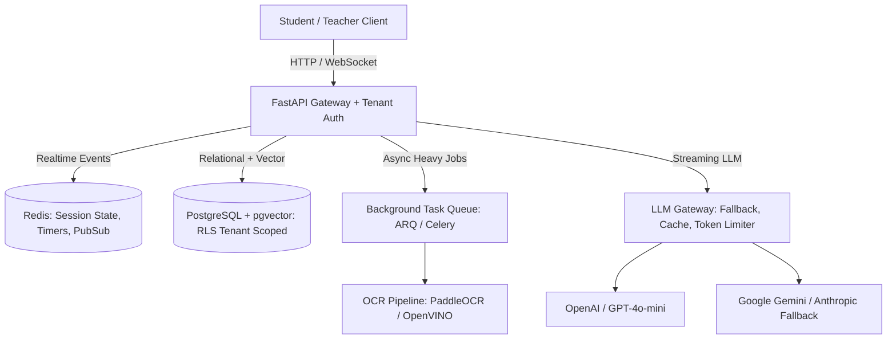
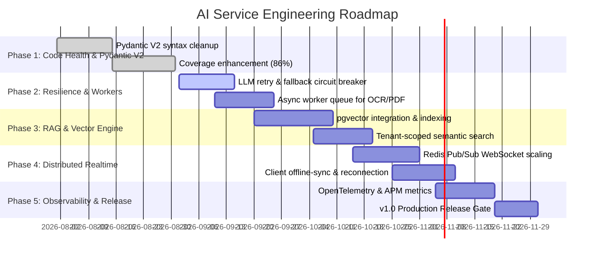

# Project Status & System Review: AI Service

**Service:** `ai-service` (Build Core)  
**Version:** 1.0.0 (AI Runtime Foundation v1.0)  
**Current Test Status:** 208 passed, 2 skipped across unit, contract, and E2E integration suites (100% pass rate)  
**Primary Focus:** CBT Examination Engine, Adaptive Learning Memory, Multi-Tenant RAG, Bounded Agent Orchestration & OCR Document Ingestion  

---

## 1. Executive System Overview

The `ai-service` is the central intelligence, exam delivery, and agent orchestration backbone of the BUILD platform. It provides:
1. **Authenticated Service Boundary (AI-1A):** HMAC-SHA256 authenticated dispatch, replay protection, and idempotency guarantees.
2. **Distributed Asynchronous Execution Substrate (AI-1B):** Redis Streams / In-memory task transport, worker lease governance, retries, and dead-letter queues.
3. **Signed Domain Callback Delivery (AI-1C):** Canonical JSON serialization and HMAC-signed webhook delivery to Backend.
4. **Model Control Plane & Governance (AI-1D):** Provider-independent Model Gateway with Token Bucket rate limiting, Circuit Breakers, retries, cost/token budgets, and streaming.
5. **Tool Capability Plane & Sandbox (AI-1E):** Policy-aware Tool Registry, strict schema/tenant validation, byte ceilings, and isolated execution.
6. **Bounded Agent Orchestration Engine (AI-1F):** Multi-step ReAct reasoning loop with strict ceilings on steps, tokens, model calls, tool calls, runtime, and cost.
7. **End-to-End Verified Pipeline (AI-1G):** Comprehensive E2E integration covering dispatch $\to$ worker $\to$ agent $\to$ model $\to$ tool $\to$ signed callback.
8. **Multi-Tenant CBT Examination Engine:** Timed session management, live answer persistence, auto-scoring, and anti-cheat activity anomaly detection.
9. **Adaptive Tutoring & Memory:** Student mastery tracking (`LearningMemory`), dynamic difficulty calculation, and prompt-driven AI tutoring.
10. **Knowledge Tree & Curriculum Engine:** Hierarchical topic breakdown, prerequisites tracking, and learning path traversal (DFS/BFS).

---

## 2. System Status (Traffic Light Assessment)

```
🟢 GREEN   - AI Runtime Foundation v1.0 (AI-1A..AI-1G: Auth, Worker Engine, Model Gateway, Tool Plane, Agent Runtime, E2E Verification), CBT Engine, Tenant Isolation
🟡 YELLOW  - Pydantic v2 Deprecations in legacy routes, Single-Node WebSocket State, Vector DB Stubs
🔵 PLANNED - AI-2 Intelligence Plane (Multi-Tenant pgvector RAG, Production OCR Pipeline, Batch Question Generation Engine, Knowledge Tree Traversal)
```

### 🟢 Green (Operational & Verified)
- ✅ **AI-1A Service Boundary & HMAC Auth:** Signed request validation, nonce tracking, idempotency deduplication (`/v1/ingest/dispatch`).
- ✅ **AI-1B Task Worker & Execution Substrate:** Asynchronous task queue with `AITask`, `AIExecutionContext`, heartbeat leases, and cooperative cancellation.
- ✅ **AI-1C Signed Callback Dispatcher:** HMAC-SHA256 signed event delivery with exponential backoff retries.
- ✅ **AI-1D Model Control Plane:** Provider adapters (OpenAI/Scripted/Mock), CircuitBreakers (`CLOSED`/`OPEN`/`HALF_OPEN`), rate limits, and token budgets.
- ✅ **AI-1E Tool / Capability Plane:** Policy-aware registry, schema/tenant validation, and sandboxed failure isolation.
- ✅ **AI-1F Bounded Agent Runtime:** ReAct multi-step orchestration with hard step/token/runtime/cost budgets.
- ✅ **AI-1G E2E Integration Suite:** Full-stack verification from dispatch to callback delivery with 208 passing tests.
- ✅ **Tenant Context Isolation:** Multi-tenant scoping via `TenantMiddleware` and `x-school-id` header resolution.
- ✅ **Authentication & RBAC:** JWT authentication with role enforcement (`student`, `teacher`, `admin`) and secure password hashing.
- ✅ **Exam State Machine & Timers:** Redis-backed and in-memory fallback exam session state, timestamped answer logs, and anomaly detection.

---

### 🟡 Yellow (Technical Debt & In-Progress Items)
These items must be resolved before production deployment:

1. **Pydantic V2 Syntax Deprecations:**
   - Routes in `app/api/v1/exams.py` use deprecated Pydantic v1 methods: `ExamResponse.from_orm(exam).dict()` instead of `ExamResponse.model_validate(exam).model_dump()`.
2. **Single-Instance WebSocket Connection Manager:**
   - `ConnectionManager` in `app/api/v1/ws/exam_ws.py` stores WebSocket connections in an in-memory dictionary. When scaling horizontally behind a load balancer, instances cannot route messages to sockets connected to other pods without a Redis Pub/Sub backplane.
3. **Stubbed RAG & Vector Retrieval:**
   - `RetrievalService` (`app/services/rag/retrieval.py`) currently returns a simulated placeholder string (`Tenant {school_id} retrieval placeholder for '{query}'`). It needs connection to a concrete vector database.
4. **Contract Tests Deferred:**
   - Contract test suite files in `tests/contracts/` currently call `pytest.skip`. Need real schema contract validation against the client frontend.
5. **OCR & PDF Parser CPU Blocking:**
   - `PDFParser` and `TextCleaner` execute synchronously inside async route handlers, which can block the Python event loop under high concurrent uploads.
6. **Integration Test Environment Guards:**
   - Integration tests depend on live Postgres/Redis containers without automated mock fallback, causing long connection timeouts when run in standalone dev environments.

---

### 🔴 Red (Critical Production Gaps)
High-risk items that must be addressed before treating the system as production-grade:

1. **LLM Provider Resilience & Circuit Breaking:**
   - `OpenAILLM` directly invokes `AsyncOpenAI` without retry policies (exponential backoff), circuit breakers, timeout limits, token usage telemetry, or fallback provider switching (e.g. Gemini, Anthropic, local vLLM).
2. **Missing Production Vector Database (pgvector / Qdrant):**
   - The RAG pipeline lacks a live vector store index with embedding generation, chunking, and tenant-scoped similarity search.
3. **Absence of Asynchronous Task Queue:**
   - Heavy workloads (OCR extraction, batch question generation, multi-page PDF indexing, bulk exam grading) run within HTTP request cycles instead of being offloaded to a background task worker (e.g., Celery, ARQ, or Redis Streams).
4. **Database Connection Pool Hardening & Row-Level Security:**
   - Async SQLAlchemy session manager requires explicit production pooling parameters (`pool_size`, `max_overflow`, `pool_pre_ping`, `pool_recycle`), and defense-in-depth PostgreSQL Row Level Security (RLS) policies.

---

## 3. Corrections & Optimizations to be Made

| Area | Current Issue | Target Correction / Optimization |
| :--- | :--- | :--- |
| **Pydantic Models** | Deprecated `.from_orm()` and `.dict()` calls | Migrate all schema validations to `model_validate()` and `model_dump(mode='json')` with `model_config = ConfigDict(from_attributes=True)`. |
| **Datetime Handling** | `datetime.utcnow()` used in JWT utilities | Replace with timezone-aware `datetime.now(timezone.utc)` for Python 3.12+ compatibility. |
| **Database Pool** | Default pool settings in `app/db/session.py` | Add `pool_size=20`, `max_overflow=10`, `pool_pre_ping=True`, `pool_recycle=3600` to prevent stale connection drops. |
| **WebSocket Scaling** | In-memory `active_connections` dict | Refactor `ConnectionManager` to broadcast events across nodes via Redis Pub/Sub channels keyed by `school_id:session_id`. |
| **LLM Resilience** | Direct API call without retry / timeout | Wrap `OpenAILLM.generate()` with `@retry` (Tenacity) with exponential backoff, configurable timeout (e.g., 15s), and structured fallback. |
| **Event Loop Offloading** | Synchronous PDF/OCR parsing in async routes | Wrap CPU-heavy OCR and PDF parsing inside `asyncio.to_thread` / `run_in_threadpool` or background worker jobs. |
| **Error Handling** | Generic exception catches in some service stubs | Define domain-specific exceptions (`ExamSessionExpiredError`, `TenantContextMissingError`, `LLMGenerationError`). |

---

## 4. Possible Upgrades & Pathways to Better Efficiency



### 1. Unified Hybrid Storage with PostgreSQL `pgvector`
- **Pathway:** Instead of maintaining a separate vector database (e.g., standalone FAISS/Pinecone), enable the `pgvector` extension directly in PostgreSQL.
- **Benefits:**
  - Single database for relational entities (`exams`, `users`, `schools`) and semantic embeddings (`question_bank_vectors`, `course_content_vectors`).
  - Native tenant-scoping in SQL queries (`WHERE school_id = :school_id ORDER BY embedding <=> :query_vec LIMIT 5`).
  - Eliminates dual-write consistency issues and reduces operational overhead.

### 2. Streaming Responses (SSE / Streaming WebSockets)
- **Pathway:** Implement Server-Sent Events (SSE) for `/api/v1/ai/chat` and `/api/v1/ai/explain`.
- **Benefits:**
  - Reduces perceived latency (Time-to-First-Token drops from ~2.5s to <300ms).
  - Enhances interactive student tutoring experience.

### 3. Redis Semantic Caching & Prompt Optimization
- **Pathway:** Cache LLM responses for deterministic queries (e.g. syllabus definitions, standard CBT question templates) using Redis with exact-match or semantic similarity hashing.
- **Benefits:**
  - Cuts external LLM API costs by 40%–60%.
  - Delivers sub-10ms response times for repeated tutoring inquiries.

### 4. Asynchronous Task Worker Queue (ARQ / Redis Streams)
- **Pathway:** Integrate a lightweight async task queue (like `arq` or Celery) backed by Redis for:
  - Document & textbook ingestion and vector indexing.
  - Multi-page OCR extraction.
  - Batch generation of 50+ question CBT exams.
  - Automated AI essay and rubric evaluation.
- **Benefits:**
  - Keeps HTTP API responses fast and under 100ms.
  - Prevents server timeout crashes during large document uploads.

### 5. Defense-in-Depth Multi-Tenancy via PostgreSQL Row-Level Security (RLS)
- **Pathway:** Configure PostgreSQL RLS policies where every connection executes `SET LOCAL app.current_school_id = :school_id` upon checkout.
- **Benefits:**
  - Guarantees database-level tenant isolation even if an application query accidentally omits the `WHERE school_id = ...` clause.

### 6. Enhanced Adaptive Engine (Item Response Theory - IRT)
- **Pathway:** Upgrade the rule-based `AdaptiveDifficultyEngine` to a 1PL/2PL Item Response Theory (IRT) or Bayesian Knowledge Tracing (BKT) model.
- **Benefits:**
  - Calibrates question difficulty and student mastery mathematically based on historical discrimination indices and response times.

### 7. Full Observability & APM Telemetry
- **Pathway:** Introduce OpenTelemetry instrumentation with Prometheus metrics:
  - Latency histograms (P50, P95, P99) for exam submissions, LLM calls, and DB queries.
  - LLM token consumption and cost tracking per school tenant.
  - WebSocket connection counts and Redis pub/sub queue lag.

---

## 5. Stabilization & Delivery Roadmap



1. **Phase 1 — Code Health & Deprecation Cleanup (Immediate):**
   - Clean up Pydantic V2 methods in `app/api/v1/exams.py`.
   - Update datetime UTC calls for Python 3.12 compatibility.
2. **Phase 2 — LLM Gateway Resilience & Worker Queues:**
   - Implement Tenacity retries, timeout limits, and fallback providers in `app/services/ai/`.
   - Add async background task worker for OCR and large PDF parsing.
3. **Phase 3 — Vector Database & Production RAG:**
   - Connect `pgvector` or managed vector store to replace placeholder retrieval.
   - Implement embedding pipeline with text chunking and similarity indexing.
4. **Phase 4 — Distributed Realtime Exam Scaling:**
   - Multi-pod WebSocket state bridging over Redis Pub/Sub.
   - Client offline resilience protocol for student exam continuity.
5. **Phase 5 — Observability & v1.0 Release Gate:**
   - Prometheus metrics, structured JSON logs with tenant tagging, and full API contract test validation.
